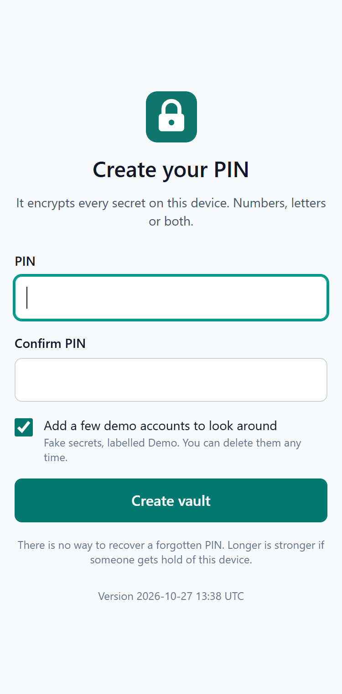
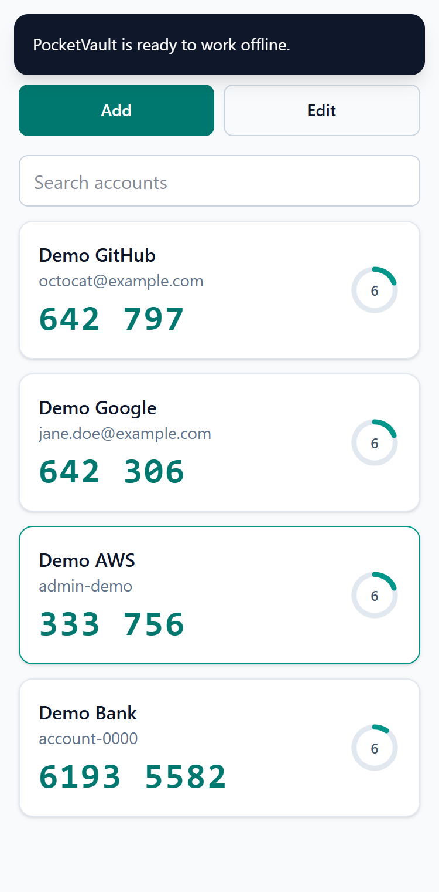
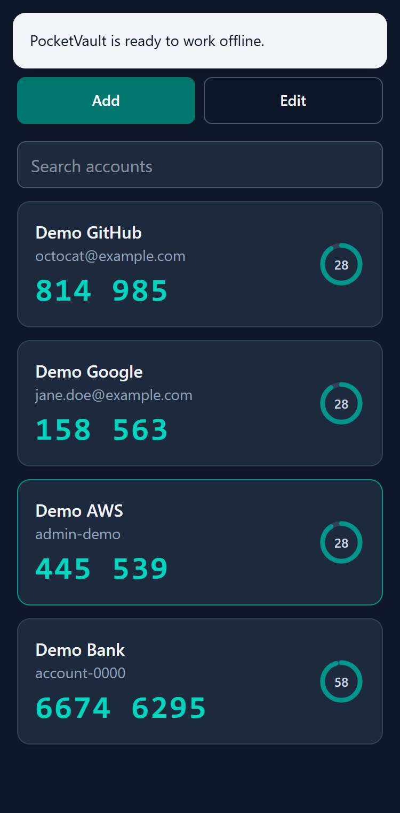
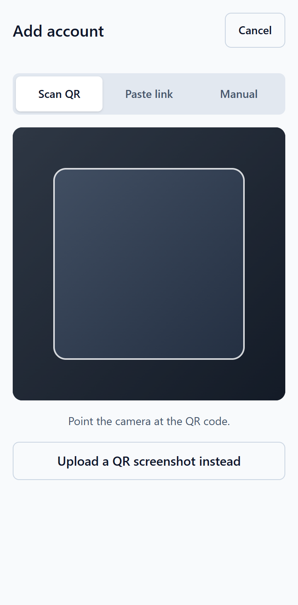
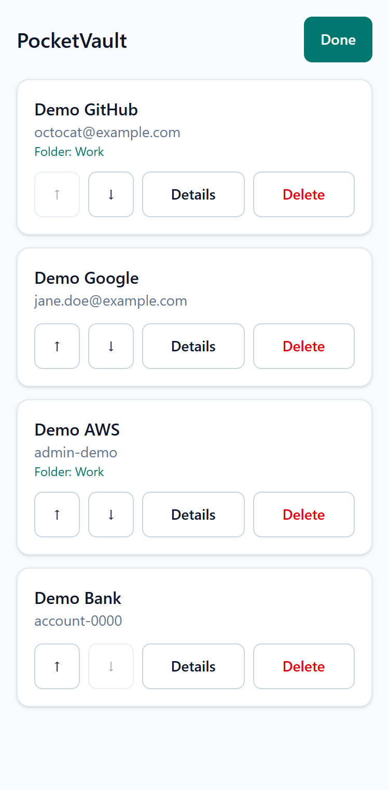
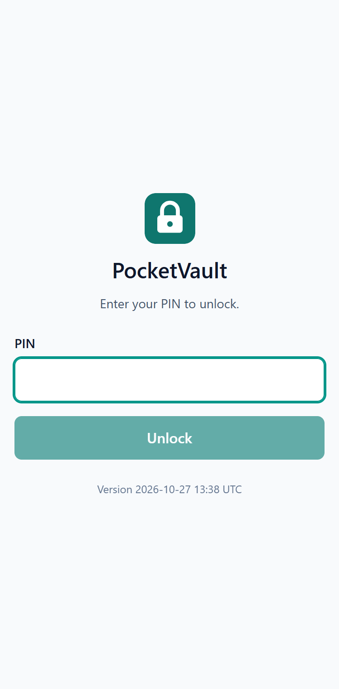
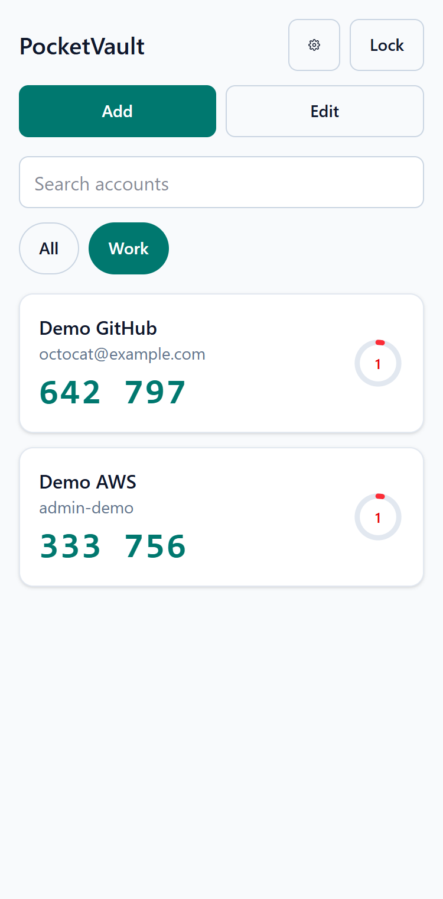
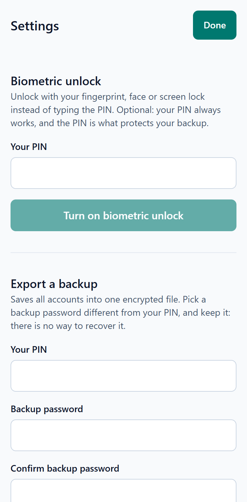

# PocketVault

An offline two-factor authenticator that runs entirely in the browser. Scan or paste an `otpauth` link, get rolling 6 or 8 digit codes with a countdown, and keep every secret encrypted on the device behind a PIN, with optional fingerprint or face unlock and encrypted backups. No backend, no account, no network needed once installed.

**Live demo:** https://pocketvault-brandon.netlify.app

| Create PIN | Codes (light) | Codes (dark) |
| :---: | :---: | :---: |
|  |  |  |

| Scan a QR code | Edit and reorder | Locked |
| :---: | :---: | :---: |
|  |  |  |

| Folders and search | Settings: biometrics and backup |
| :---: | :---: |
|  |  |

## What to demo to a recruiter

1. **Create a PIN and see demo accounts appear.** The four "Demo" accounts use fake secrets, so the app looks alive immediately. Tap a code to copy it and watch the ring turn red in the last 5 seconds.
2. **Go offline.** Turn on airplane mode (or use DevTools offline), reload, unlock and add an account. Everything still works, and the app makes no requests to any other origin.
3. **Try to break in.** Enter a wrong PIN three times to trigger the escalating lockout, then reload: the delay survives. Inspect IndexedDB and there is no plaintext secret anywhere. Then export a backup, open the file, and see that it is unreadable without its password.

## Features

- **TOTP engine (RFC 6238)** using Web Crypto HMAC, with SHA-1, SHA-256 and SHA-512, 6 or 8 digits and custom periods. Checked against all the RFC 6238 test vectors.
- **Live account list** with a countdown ring, tap-to-copy, and a ring that turns red near rollover. Respects reduced-motion settings.
- **Three ways to add an account:** camera QR scan, pasted `otpauth://` link, or manual entry with advanced options. QR screenshots can also be uploaded, which helps on desktops without a camera.
- **Encrypted storage:** a PIN-derived key encrypts each secret with AES-GCM. Nothing readable is stored.
- **Lockout and auto-lock:** three free wrong PINs, then 30 s, 1 min, 2 min and so on up to an hour. The vault locks after 2 minutes idle or after 30 s in the background.
- **Rename, delete and reorder** accounts, with a confirm step before deleting.
- **Folders and search.** Group accounts into folders, filter by folder chip, and search by service, account or folder.
- **Counter-based (HOTP) accounts** per RFC 4226, with a Next button that advances the stored counter (checked against the RFC test vectors).
- **Encrypted backup and restore.** Export every account into one file encrypted with a separate password (PBKDF2 + AES-GCM, PIN re-checked first). Import skips accounts already present, so restoring twice changes nothing.
- **Optional biometric unlock** with a fingerprint, face or screen lock through WebAuthn. It is off by default, the PIN always works, and it only appears on devices that support the PRF extension.
- **Installable PWA** with a service worker, offline app shell, and an update banner that never reloads on its own.
- **Light and dark themes** that follow the system setting, accessible controls, 44 px touch targets, safe-area support for notched phones.

### Ideas for later

- A change-PIN screen (today the PIN is fixed once set)
- Setting a folder while adding an account, and folder rename
- Syncing between devices (deliberately out of scope: there is no backend)

## Stack

React 19, Vite, TypeScript (strict, no `any`), Tailwind CSS 4, Web Crypto API (HMAC, PBKDF2, AES-GCM), `jsqr` for QR decoding, IndexedDB, `vite-plugin-pwa`, Vitest. No backend. Hosted on Netlify as static files.

## Architecture notes

```
src/
  types/            TokenAccount, StoredSecret, VaultMeta
  features/
    totp/           Base32 decoding, RFC 6238 engine, otpauth parser
    vault/          Key derivation, encryption, PIN setup/unlock, lockout, auto-lock, demo data
    storage/        Thin IndexedDB layer with transactions
    accounts/       List, add, edit, reorder, folders, search, dialogs
    backup/         Encrypted backup format, export and import
    biometric/      WebAuthn PRF wrapping of the vault key
    settings/       Biometric toggle, backup export and import screens
    scan/           Camera and image QR decoding
    lock/           PIN setup and lock screens
    pwa/            Update banner
  shared/           Small hooks
```

**How the secrets are protected**

- The PIN goes through PBKDF2-SHA256 (600,000 iterations, random 16-byte salt) to produce a non-extractable AES-256-GCM key. The key lives in memory only and is dropped on lock.
- Each secret is encrypted with a fresh random IV. The account ID is bound in as authenticated data, so a ciphertext cannot be moved to a different account.
- There is no stored PIN hash. A known string is encrypted with the key and stored as a verifier, so a wrong PIN simply fails to decrypt.
- After unlock, each secret is imported once as a non-extractable HMAC key and the plaintext bytes are zeroed, so codes tick without keeping readable secrets around.
- The lockout counters are stored in the vault metadata and enforced before any key derivation is attempted.
- **Backups** are encrypted with a key made from a separate backup password (PBKDF2, 600,000 iterations, random salt, AES-GCM with the format name as authenticated data). The file holds no readable names or secrets. A backup file is treated as untrusted input: every field is validated, and a cost parameter far outside the normal range is rejected.
- **Biometric unlock** creates a passkey on the device and asks it for a PRF secret, which the authenticator only releases after the fingerprint, face or screen-lock check. That secret encrypts a copy of the vault key kept in IndexedDB, so the stored copy is useless without the authenticator. Turning it on needs the PIN, and it only offers itself where the PRF extension works.

**Testing:** 133 unit tests cover the TOTP engine against every RFC 6238 vector, the HOTP engine against the RFC 4226 vectors, Base32 and `otpauth` parsing, the crypto layer (wrong PIN, tampering, moved ciphertexts, fresh IVs), the lockout schedule, storage (including concurrent counter updates), folders and search, reordering, QR decoding, the backup format (round trip into a different vault, wrong password, tampering, untrusted input, duplicate handling) and the biometric key wrapping. During development I also drove the real app in Edge with scripted browser sessions (setup, lockout, scanning with a fake camera, HOTP, folders, backup export and import between two separate vaults, biometric enrolment and unlock with a virtual authenticator, offline reload with the network cut, the update banner, and layout checks from 320 to 1280 px in light and dark). Those scripts are not part of this repository, and biometric unlock and camera scanning have not been tried on every real device.

## Security model and limitations

PocketVault is a portfolio project. It has not had an independent security review, so do not rely on it for accounts you cannot afford to lose.

- **The lockout is client-side.** Someone with developer tools can skip it. What actually slows offline guessing is the PBKDF2 cost, so a longer PIN matters. The setup screen requires at least 6 characters and accepts letters.
- **Issuer and account names are stored unencrypted** so the list can render before decryption. Only the secrets are encrypted.
- **There is no PIN recovery.** Forgetting it means the secrets cannot be read. The way back is a backup: export one from Settings and keep both the file and its password somewhere safe.
- **A backup is only as strong as its password.** Anyone with the file can guess passwords offline, slowed by PBKDF2. It needs at least 10 characters, and a long passphrase is much better.
- **Biometric unlock moves trust to the device.** Anyone who can pass the phone's own fingerprint, face or screen-lock check can open the vault. Leave it off if that is not acceptable. The passkey it creates stays in the device's password manager until you delete it there.
- **Clearing site data deletes the vault.** There is no sync by design.
- **The clipboard** holds a copied code until something else replaces it.
- **Secrets briefly exist as strings** in memory during decryption. JavaScript cannot reliably wipe a string.

## Run locally

```bash
npm install
npm run dev        # http://localhost:5173
npm test           # unit tests
npm run lint
npm run typecheck
npm run build      # type-check, then production build with the service worker
npm run preview    # serve the production build
```

Camera scanning and the Web Crypto API need a secure context: HTTPS or `localhost`. To try it on an Android phone over USB, enable USB debugging, then run `adb reverse tcp:5173 tcp:5173` and open `http://localhost:5173` in Chrome on the phone. Opening the dev server by your computer's LAN address will not work, because that is not a secure context.

No environment variables are needed (see `.env.example`).

## Deploy

Netlify builds with `npm run build` and publishes `dist/`. `netlify.toml` sets the SPA fallback, allows the camera for this origin, and adds a strict Content-Security-Policy (everything same-origin, no inline scripts or styles, no external connections) plus a few other security headers.

## Status

MVP and Phase 2 complete: TOTP and HOTP engines, account list, three ways to add accounts, encrypted storage, lockout and auto-lock, folders and search, encrypted backup and restore, optional biometric unlock, offline PWA.
